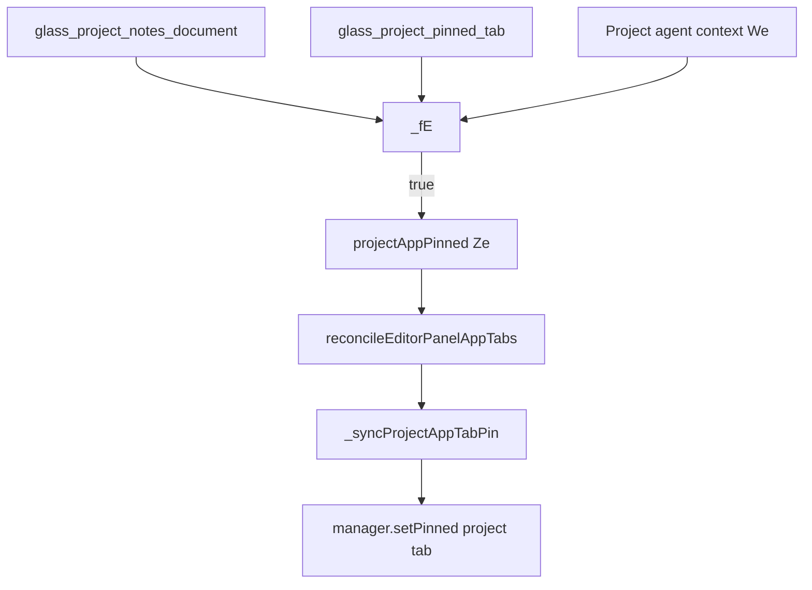

# Detective: feature-flag-glass-project-pinned-tab

## Objective

Determine how `glass_project_pinned_tab` affects Glass project editor-panel tabs, what other gates apply, and whether behavior is registry-only on desktop.

## Environment

- Cursor **3.23.5** / commit `a34aa15953a79dfe2ada63f5460efa79005dfbb5`
- Workbench: extracted `workbench.glass.main.js` + desktop twin (`workbench.desktop.main.js`)
- Feature registry minify symbols: desktop `G9e`, glass `Z3e`
- `state.vscdb`: missing → local override **none**

## Scan checklist

| Script / probe | Exit | Result |
|----------------|------|--------|
| `locate-cursor.sh` | 0 | No live install; used extract path |
| `scan-paths.sh` | 0 | No global `state.vscdb` |
| `probe-flag.py` | 0 | client=true, default=false; glass_count=2 |
| `grep-workbench.sh` | 0 | Registry + `_fE` gate in glass bundle |

## Findings

### Registry (Confirmed)

- **Confirmed:** `glass_project_pinned_tab:{client:!0,default:!1}` in client feature map (inventory + bundle).

### Composite gate helper (Confirmed)

- **Confirmed:** `rwn="glass_project_notes_document"` and:

```javascript
function _fE(t) {
  const e = wa(rwn),
        n = o_("glass_project_pinned_tab", t && e);
  return t && e && n;
}
```

Pinned project tab behavior requires **both** `glass_project_notes_document` and this flag, plus caller context `t` (project agent context).

### Agent shell wiring (Confirmed)

- **Confirmed:** In agent editor chrome, `We=O6f({header, parentHeader})&&!Pe` (project context), then `Ze=_fE(We)`.
- **Confirmed:** `projectAppPinned:Ze` passed into `reconcileEditorPanelAppTabs(Cn)` via editor-panel controller.

### Tab pin side effect (Confirmed)

- **Confirmed:** `reconcileEditorPanelAppTabs` sets `_projectAppTabPinned=t.projectAppPinned` and calls `_syncProjectAppTabPin()`.
- **Confirmed:** `_syncProjectAppTabPin` calls `manager.setPinned({groupId, tabId:aie, pinned:this._projectAppTabPinned})` for the project app tab.

### Desktop bundle (Confirmed)

- **Confirmed:** Desktop `workbench_count=1` (registry only); interactive pin logic lives in glass bundle.

## Internal code map

| Area | Symbols / modules | Role |
|------|-------------------|------|
| Notes prerequisite | `rwn`, `wa(rwn)` in `project-document.ts` | Notes document feature must be on |
| Flag read | `o_("glass_project_pinned_tab", …)`, `_fE` | Client gate helper |
| Agent UI | `running-extensions-window.react.js` chunk | Computes `projectAppPinned` for project agents |
| Editor panel | `reconcileEditorPanelAppTabs`, `_syncProjectAppTabPin` | Applies pinned state to project app tab |
| Tab id | `aie` | Stable tab id for project app |

## Diagram



## Gaps & follow-ups

- Exact UX label/icon for pinned project tab not traced in this pass (pin is structural via tab manager).
- `aie` human-readable tab name not resolved from minified bundle.

## Workspace relevance

None.
