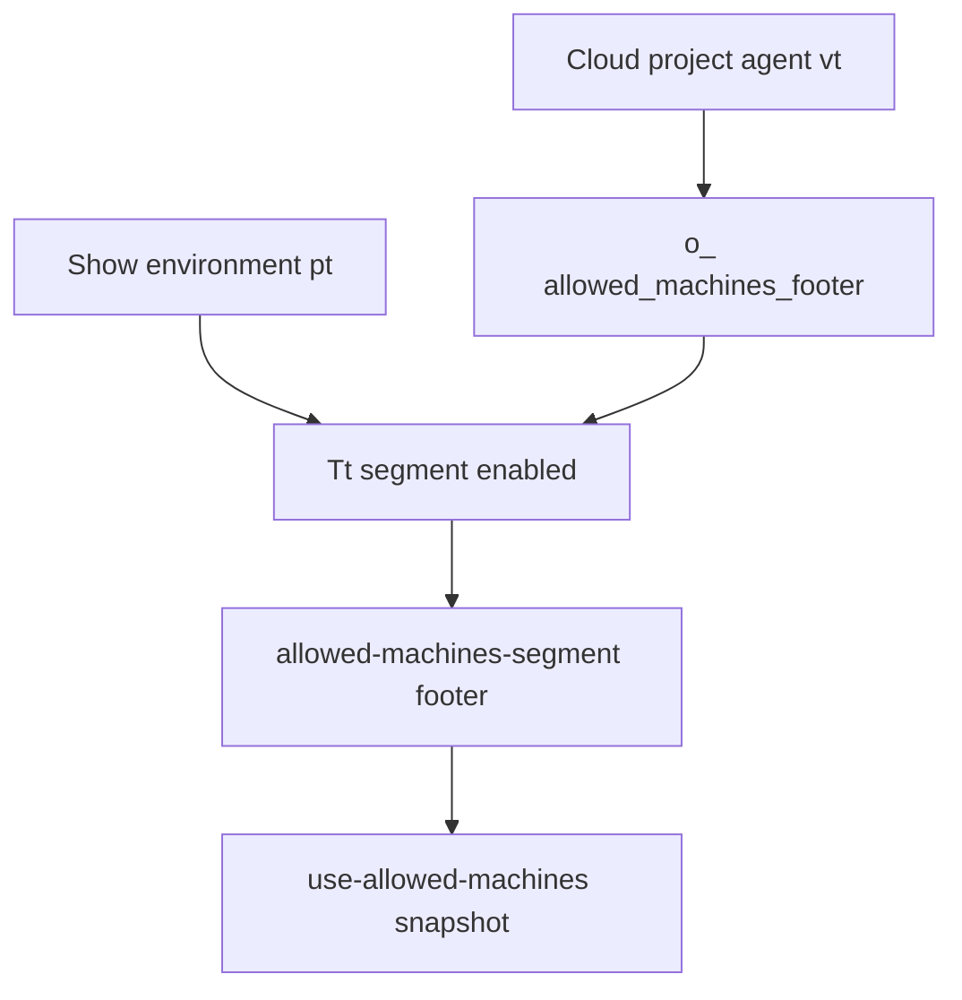

# Detective: feature-flag-glass-projects-allowed-machines-footer

## Objective

Determine how `glass_projects_allowed_machines_footer` controls allowed-machines UI in Glass chat status bar for cloud project agents.

## Environment

- Cursor **3.23.5** / commit `a34aa15953a79dfe2ada63f5460efa79005dfbb5`
- Extracted `workbench.glass.main.js` + desktop twin
- `state.vscdb`: missing → local override **none**

## Scan checklist

| Script / probe | Exit | Result |
|----------------|------|--------|
| `locate-cursor.sh` | 0 | Extract path |
| `scan-paths.sh` | 0 | No state DB |
| `probe-flag.py` | 0 | glass_count=2; status bar `o_` call |
| `grep-workbench.sh` | 0 | Registry + allowed-machines strings |

## Findings

### Registry (Confirmed)

- **Confirmed:** `glass_projects_allowed_machines_footer:{client:!0,default:!1}` in client feature map.

### Status bar gate (Confirmed)

- **Confirmed:** In `ZpC` (glass chat status bar), eligibility chain:

```javascript
ut = C && n.source === "cloud" && Rc(n.id);  // cloud project agent surface
wt = o_("glass_projects_allowed_machines_footer", vt);
Tt = vt && wt && pt;  // pt = glassStatusBarShowEnvironment preference
Ht = /* other segments */ || Tt;
```

- **Confirmed:** When `Tt`, renders `jhC` (`allowed-machines-segment.react.js`) with `agentWorkspace`, `projectRootAgentId`, compact layout props.

### Allowed machines subsystem (Confirmed)

- **Confirmed:** Related copy keys `glass.allowedMachines.*` (unknown machine, in use, offline, pool connected).
- **Confirmed:** Hook module `use-allowed-machines.react.js` loads snapshot/menu rows for worker/pool targets.

### Desktop bundle (Confirmed)

- **Confirmed:** Registry on desktop only; footer segment is glass chat status bar code.

## Internal code map

| Area | Symbols / modules | Role |
|------|-------------------|------|
| Flag | `o_("glass_projects_allowed_machines_footer", vt)` | Client gate |
| Eligibility | `vt` cloud + `source==="cloud"` + `Rc(agentId)` | Cloud project agents only |
| Preference | `glassStatusBarShowEnvironment` (`pt`) | User/env toggle for environment segment |
| UI | `allowed-machines-segment.react.js` (`jhC`) | Footer control in status bar |
| Data | `use-allowed-machines.react.js` | Machine/pool snapshot + selection |

## Diagram



## Gaps & follow-ups

- `Rc(agentId)` helper semantics (project-root detection) not fully decompiled.

## Workspace relevance

None.
