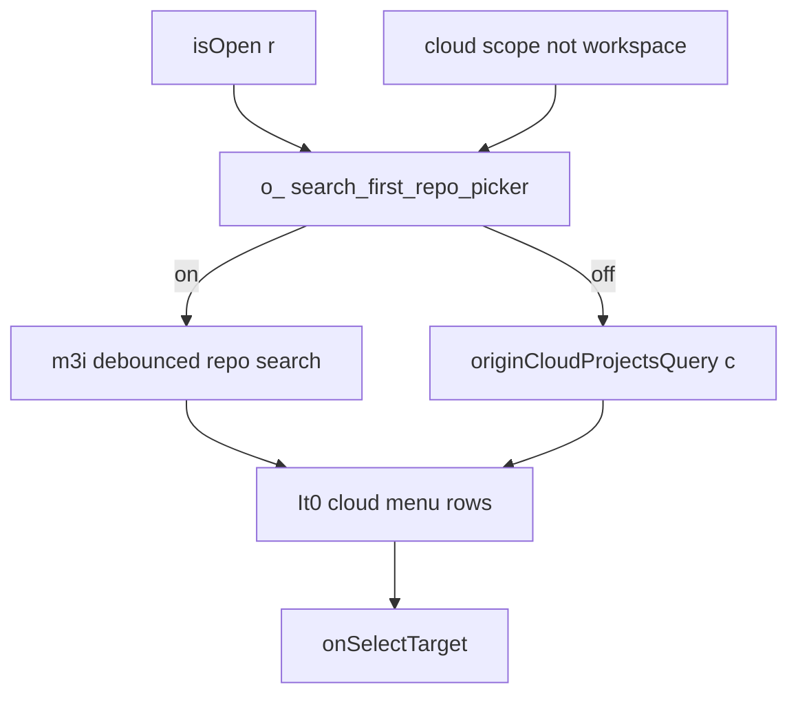

# Detective: feature-flag-glass-search-first-repo-picker

## Objective

Determine how `glass_search_first_repo_picker` changes cloud project/repo picker data loading and menu layout in Glass.

## Environment

- Cursor **3.23.5** / commit `a34aa15953a79dfe2ada63f5460efa79005dfbb5`
- Extracted `workbench.glass.main.js` + desktop twin
- `state.vscdb`: missing → local override **none**

## Scan checklist

| Script / probe | Exit | Result |
|----------------|------|--------|
| `locate-cursor.sh` | 0 | Extract path |
| `scan-paths.sh` | 0 | No state DB |
| `probe-flag.py` | 0 | `vn0` + `m3i` search hook |
| `grep-workbench.sh` | 0 | Registry + call site |

## Findings

### Registry (Confirmed)

- **Confirmed:** `glass_search_first_repo_picker:{client:!0,default:!1}` near other glass workspace flags.

### Picker entry (`vn0`) (Confirmed)

- **Confirmed:**

```javascript
x = o_("glass_search_first_repo_picker", r && C !== "workspace");
P = m3i({
  enabled: r && C !== "workspace" && (c === void 0 || R),
  search: h
});
N = C !== "workspace" ? (R || c === void 0 ? P : c) : void 0;
```

- **Confirmed:** When flag on and cloud picker open (non-workspace scope), enables debounced repo search (`m3i` → `fPf`) instead of relying solely on preloaded `originCloudProjectsQuery` until user types.
- **Confirmed:** Infinite scroll via `fetchNextPage` when `jOl` signals bottom reached.

### Menu model propagation (Confirmed)

- **Confirmed:** `use-project-selector-menu-model.react.js` exports `searchFirstRepoPickerEnabled: x` with recents/search results.
- **Confirmed:** `project-selector-menu-rows.react.js` passes `searchFirstRepoPicker` into cloud rows (`It0` / `Mt0`).
- **Confirmed:** In `It0`, `ue = le && a` where `le` is cloud target without repository pool — drives search-first catalog path (`Ksv` hits, `catalogIncomplete` in empty/loading predicates).

### Desktop bundle (Confirmed)

- **Confirmed:** Desktop registry only; selector UX is glass bundle.

## Internal code map

| Area | Symbols / modules | Role |
|------|-------------------|------|
| Flag | `o_("glass_search_first_repo_picker", r && C!=="workspace")` | Gate when picker open |
| Search hook | `m3i` / `fPf` | Debounced paginated repo query |
| Selector shell | `vn0` (cloud project selector) | Chooses preloaded vs search data source |
| Menu rows | `project-selector-menu-rows.react.js`, `It0` | Cloud list + search-first mode |
| Model | `use-project-selector-menu-model.react.js` | Aggregates entries for menu |

## Diagram



## Gaps & follow-ups

- Exact API behind `fPf` / `m3i` not traced to RPC service name in this pass.

## Workspace relevance

None.
