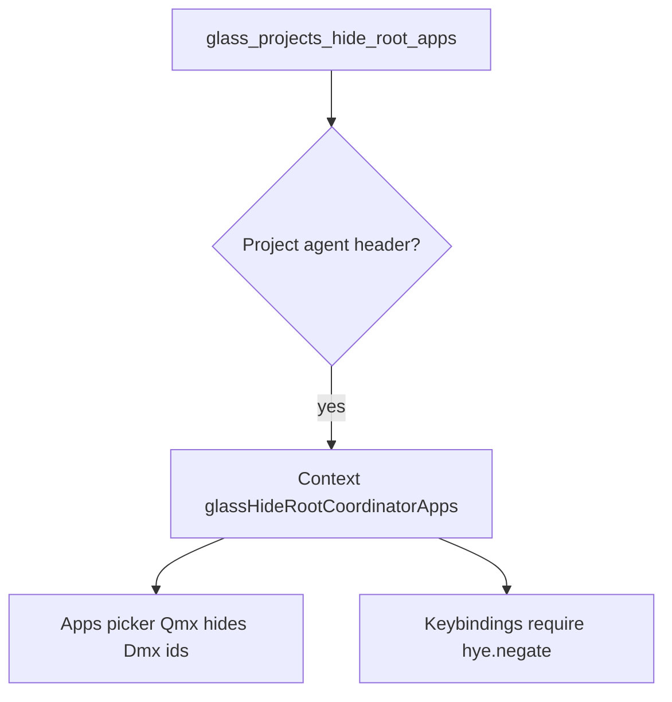

# Detective plan: `glass_projects_hide_root_apps`

## Objective

Trace `glass_projects_hide_root_apps` from registry through Glass project coordinator UI and keybinding `when` clauses.

**Theme:** `feature-flag-glass-projects-hide-root-apps`

**Success criteria:** Registry entry confirmed; bundle consumers cataloged; on/off behavior stated with evidence tags; local override status recorded.

**Assumptions:** Extracted Cursor 3.25.4 bundles match production; `_l` / `yb` / `checkFeatureGate` are client feature-gate reads.

**Unknowns:** Per-user gate overrides without `state.vscdb`.

## Environment

- **OS:** Linux (cloud agent VM)
- **Cursor version:** 3.25.4 (`commit_sha` ad3448499a35d8ad059c4f95e50d40ae862d9d45 per `feature-flags-inventory.json`)
- **locate-cursor.sh:** exit 0; `WORKBENCH_JS` empty (no live install on VM)
- **Workbench bundles used (extract):**
  - Desktop: `/workspace/workspace/runs/20261015T110519Z/extract/new/usr/share/cursor/resources/app/out/vs/workbench/workbench.desktop.main.js`
  - Glass: `/workspace/workspace/runs/20261015T110519Z/extract/new/usr/share/cursor/resources/app/out/vs/workbench/workbench.glass.main.js`
- **Registry symbols:** desktop `zLe`; glass `kAe` (client flag maps include each flag with `client:!0,default:!1`)

## Feature flag summary

| Field | Value |
|-------|-------|
| Flag | `glass_projects_hide_root_apps` |
| Registry | **Confirmed** — client true, default false (`zLe` desktop / `kAe` glass) |
| Local override (`state.vscdb`) | **None probed** — DB missing on VM |
| `registry_only` | **false** |
| Confidence | **Confirmed** |

## Scan checklist

| Script | Exit | Result |
|--------|------|--------|
| `locate-cursor.sh` | 0 | No local Cursor install; empty `WORKBENCH_JS` |
| `scan-paths.sh` | 0 | `global_state_vscdb_exists=false`; `projects_root_exists=true` |
| `grep-workbench.sh` (per flag) | 0 | Registry + consumer hits in glass (and desktop where noted) |
| `inspect-state-vscdb.sh` | 1 | `state.vscdb not found` at `~/.config/Cursor/User/globalStorage/state.vscdb` |

## Findings

### Registry (**Confirmed**)

- Inventory + both bundles: `client: true`, `default: false`.

### Runtime (**Confirmed** — glass consumer)

1. **Project agent detection** — `nPt(header)` returns true when header is a project agent (`Wm(t?.isProject)` and valid header). Gate read: `N = yb("glass_projects_hide_root_apps", M) && M` (only applies on project agents).

2. **Context key** — `fEe(hye, N)` sets `hye = pn("glassHideRootCoordinatorApps")`. Downstream UI reads via `Mcc(hye, {fallback:false})`.

3. **Apps picker (`Qmx`)** — When context true (`Wi`), passes `hiddenAppIds: Dmx` where `Dmx = Set(["changes","file","terminal","desktop","machine","environment"])` and `showSearch: !Wi`. Default hidden list `Er` still omits tabs not present (changes/environment/desktop).

4. **Keybindings / commands** — Multiple menu entries and chord bindings use `when: hye.negate()` (File, Find, Review Changes, Changes, Terminal, etc.), so those bindings are **inactive** while hide-root mode is active.

**Default off:** Full root apps palette + search remain for project agents (subject to tab availability).

## Internal code map

| Site | Mechanism | When flag true (on project agent) |
|------|-----------|-----------------------------------|
| Agent layout mount | `yb` + `fEe(hye)` | Sets `glassHideRootCoordinatorApps` context |
| Apps picker `Qmx` | `Mcc(hye)` → `hiddenAppIds` | Hides core root app actions; disables search |
| Command registry | `hye.negate()` when-clauses | Disables several view/file shortcuts |

### Implementation snippet (**Confirmed**)

`M=nPt(...); N=yb("glass_projects_hide_root_apps",M)&&M; fEe(hye,N)` and `hiddenAppIds:Wi?Dmx:void 0, showSearch:!Wi` in `workbench.glass.main.js`.

## Diagram

## Gaps & follow-ups

- No running Glass app UX validation on this VM.
- Per-user Statsig/gate overrides not readable without `state.vscdb`.

## Workspace relevance

Forensics against pinned extract under `workspace/runs/20261015T110519Z/`; no writes to `~/.cursor` or install trees.

