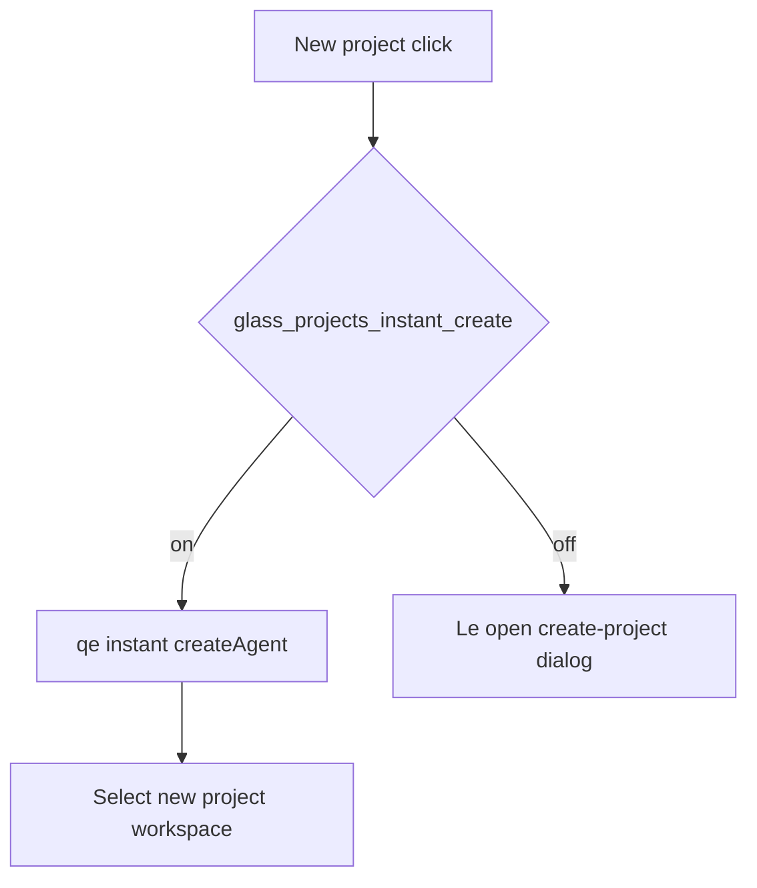

# Detective plan: `glass_projects_instant_create`

## Objective

Document how `glass_projects_instant_create` routes new-project entry away from the modal dialog.

**Theme:** `feature-flag-glass-projects-instant-create`

**Success criteria:** Registry entry confirmed; bundle consumers cataloged; on/off behavior stated with evidence tags; local override status recorded.

**Assumptions:** Extracted Cursor 3.25.4 bundles match production; `_l` / `yb` / `checkFeatureGate` are client feature-gate reads.

**Unknowns:** Per-user gate overrides without `state.vscdb`.

## Environment

- **OS:** Linux (cloud agent VM)
- **Cursor version:** 3.25.4 (`commit_sha` ad3448499a35d8ad059c4f95e50d40ae862d9d45 per `feature-flags-inventory.json`)
- **locate-cursor.sh:** exit 0; `WORKBENCH_JS` empty (no live install on VM)
- **Workbench bundles used (extract):**
  - Desktop: `/workspace/workspace/runs/20261015T110519Z/extract/new/usr/share/cursor/resources/app/out/vs/workbench/workbench.desktop.main.js`
  - Glass: `/workspace/workspace/runs/20261015T110519Z/extract/new/usr/share/cursor/resources/app/out/vs/workbench/workbench.glass.main.js`
- **Registry symbols:** desktop `zLe`; glass `kAe` (client flag maps include each flag with `client:!0,default:!1`)

## Feature flag summary

| Field | Value |
|-------|-------|
| Flag | `glass_projects_instant_create` |
| Registry | **Confirmed** — client true, default false (`zLe` desktop / `kAe` glass) |
| Local override (`state.vscdb`) | **None probed** — DB missing on VM |
| `registry_only` | **false** |
| Confidence | **Confirmed** |

## Scan checklist

| Script | Exit | Result |
|--------|------|--------|
| `locate-cursor.sh` | 0 | No local Cursor install; empty `WORKBENCH_JS` |
| `scan-paths.sh` | 0 | `global_state_vscdb_exists=false`; `projects_root_exists=true` |
| `grep-workbench.sh` (per flag) | 0 | Registry + consumer hits in glass (and desktop where noted) |
| `inspect-state-vscdb.sh` | 1 | `state.vscdb not found` at `~/.config/Cursor/User/globalStorage/state.vscdb` |

## Findings

### Registry (**Confirmed**)

- `client: true`, `default: false` in inventory and both registries.

### Runtime (**Confirmed** — glass)

1. **Entry hook `Ue`** — On new-project affordance: if `ne` (creation available), not already creating, and dialog not open, then `X.checkFeatureGate("glass_projects_instant_create")` → calls `qe()` and **returns**; else opens dialog via `Le(void 0)`.

2. **Instant path `qe`** — Sets `Me.current` guard; checks `s("new-agent")`; builds request via `Q.buildNoRepoProjectRequest({ homeWorkspaceIdentifier, dashboardUserId, firstProjectOnboardingEnabled, forceFirstProjectExperience dev gate, existingProjectCount })`; calls `I.createAgent(...)` with failure/cancel callbacks; tracks `glass.projects.created`; selects new project (`we(projectId)`).

3. **Fallback routing `Pe`** — Separate async router handles `instantCreate` outcomes (`fell_back_create_failed`, etc.) when staged/instant flows fail — still references instant create telemetry fields.

**Default off:** Standard create-project dialog (`Le`) opens on new-project click.

## Internal code map

| Function | Role |
|----------|------|
| `Ue` | Feature-gate branch: instant vs dialog |
| `qe` | Instant create: buildNoRepoProjectRequest + createAgent |
| `Le` | Dialog opener (default path) |
| `Pe` | Instant create fallback / routing |

### Implementation snippet (**Confirmed**)

`if(X.checkFeatureGate("glass_projects_instant_create",{disableExposureLog:!1})){qe();return} Le(void 0)` in `workbench.glass.main.js`.

## Diagram

## Gaps & follow-ups

- No running Glass app UX validation on this VM.
- Per-user Statsig/gate overrides not readable without `state.vscdb`.

## Workspace relevance

Forensics against pinned extract under `workspace/runs/20261015T110519Z/`; no writes to `~/.cursor` or install trees.

