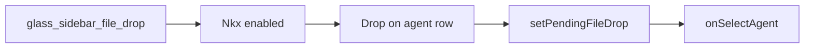

# Detective plan: `glass_sidebar_file_drop`

## Objective

Map sidebar DnD handlers gated by `glass_sidebar_file_drop`.

**Theme:** `feature-flag-glass-sidebar-file-drop`

**Success criteria:** Registry entry confirmed; bundle consumers cataloged; on/off behavior stated with evidence tags; local override status recorded.

**Assumptions:** Extracted Cursor 3.25.4 bundles match production; `_l` / `yb` / `checkFeatureGate` are client feature-gate reads.

**Unknowns:** Per-user gate overrides without `state.vscdb`.

## Environment

- **OS:** Linux (cloud agent VM)
- **Cursor version:** 3.25.4 (`commit_sha` ad3448499a35d8ad059c4f95e50d40ae862d9d45 per `feature-flags-inventory.json`)
- **locate-cursor.sh:** exit 0; `WORKBENCH_JS` empty (no live install on VM)
- **Workbench bundles used (extract):**
  - Desktop: `/workspace/workspace/runs/20261015T110519Z/extract/new/usr/share/cursor/resources/app/out/vs/workbench/workbench.desktop.main.js`
  - Glass: `/workspace/workspace/runs/20261015T110519Z/extract/new/usr/share/cursor/resources/app/out/vs/workbench/workbench.glass.main.js`
- **Registry symbols:** desktop `zLe`; glass `kAe` (client flag maps include each flag with `client:!0,default:!1`)

## Feature flag summary

| Field | Value |
|-------|-------|
| Flag | `glass_sidebar_file_drop` |
| Registry | **Confirmed** — client true, default false (`zLe` desktop / `kAe` glass) |
| Local override (`state.vscdb`) | **None probed** — DB missing on VM |
| `registry_only` | **false** |
| Confidence | **Confirmed** |

## Scan checklist

| Script | Exit | Result |
|--------|------|--------|
| `locate-cursor.sh` | 0 | No local Cursor install; empty `WORKBENCH_JS` |
| `scan-paths.sh` | 0 | `global_state_vscdb_exists=false`; `projects_root_exists=true` |
| `grep-workbench.sh` (per flag) | 0 | Registry + consumer hits in glass (and desktop where noted) |
| `inspect-state-vscdb.sh` | 1 | `state.vscdb not found` at `~/.config/Cursor/User/globalStorage/state.vscdb` |

## Findings

### Registry (**Confirmed**)

- `client: true`, `default: false`.

### Runtime (**Confirmed** — glass)

1. **Gate read** — `Iue = _l("glass_sidebar_file_drop")` in sidebar root render.

2. **Hook `Nkx({enabled, headers, onSelectAgent})`** — When enabled, registers drag-over/leave/drop listeners on sidebar container ref. Resolves target agent row via `LYb` + `Aau` attribute; validates transfer via `NYb`.

3. **Drop handler** — On drop: `setPendingFileDrop({ agentId, files, items: Dkx(dataTransfer) })` on staged tile service (`Tce`), then `onSelectAgent(header)` to focus target agent.

4. **Delivery module** — `use-sidebar-file-drop-delivery.react.js` defines `data-sidebar-file-drop-editor-agent-id` for correlating editor/agent drop targets (**Confirmed** module string in bundle).

**Default off:** `enabled:false` → `Nkx` installs no DnD listeners (early return in effect).

## Internal code map

| Component | Behavior |
|-----------|----------|
| Sidebar shell | Reads `_l("glass_sidebar_file_drop")` |
| `Nkx` | DnD listeners + pending file drop |
| `Tce` | Stores pending drop payload |
| Delivery helper | Editor/sidebar agent id attribute |

### Implementation snippet (**Confirmed**)

`Iue=_l("glass_sidebar_file_drop"); ... Nkx({enabled:Iue, headers:tn, onSelectAgent:Er})` and `setPendingFileDrop({agentId:h, files:..., items:Dkx(p)})` in `workbench.glass.main.js`.

## Diagram

## Gaps & follow-ups

- No running Glass app UX validation on this VM.
- Per-user Statsig/gate overrides not readable without `state.vscdb`.

## Workspace relevance

Forensics against pinned extract under `workspace/runs/20261015T110519Z/`; no writes to `~/.cursor` or install trees.

