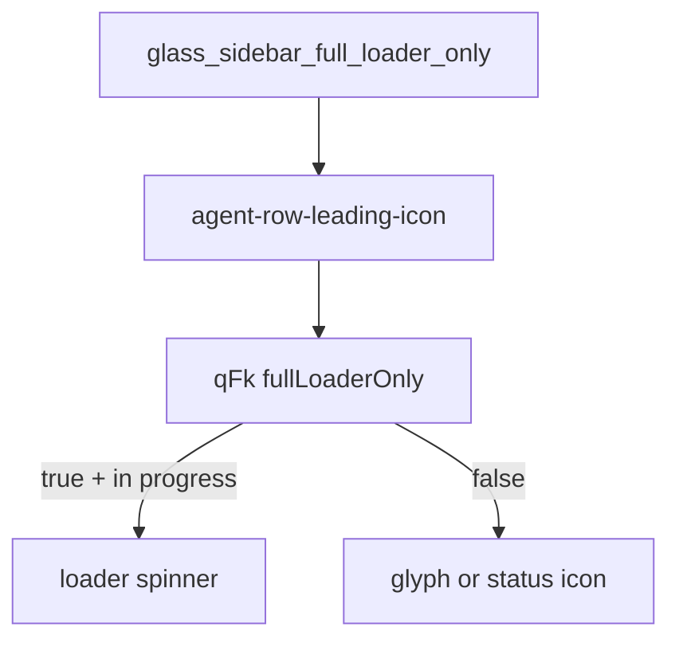

# Detective plan: `glass_sidebar_full_loader_only`

## Objective

Explain how `glass_sidebar_full_loader_only` changes agent row leading icon rendering.

**Theme:** `feature-flag-glass-sidebar-full-loader-only`

**Success criteria:** Registry entry confirmed; bundle consumers cataloged; on/off behavior stated with evidence tags; local override status recorded.

**Assumptions:** Extracted Cursor 3.25.4 bundles match production; `_l` / `yb` / `checkFeatureGate` are client feature-gate reads.

**Unknowns:** Per-user gate overrides without `state.vscdb`.

## Environment

- **OS:** Linux (cloud agent VM)
- **Cursor version:** 3.25.4 (`commit_sha` ad3448499a35d8ad059c4f95e50d40ae862d9d45 per `feature-flags-inventory.json`)
- **locate-cursor.sh:** exit 0; `WORKBENCH_JS` empty (no live install on VM)
- **Workbench bundles used (extract):**
  - Desktop: `/workspace/workspace/runs/20261015T110519Z/extract/new/usr/share/cursor/resources/app/out/vs/workbench/workbench.desktop.main.js`
  - Glass: `/workspace/workspace/runs/20261015T110519Z/extract/new/usr/share/cursor/resources/app/out/vs/workbench/workbench.glass.main.js`
- **Registry symbols:** desktop `zLe`; glass `kAe` (client flag maps include each flag with `client:!0,default:!1`)

## Feature flag summary

| Field | Value |
|-------|-------|
| Flag | `glass_sidebar_full_loader_only` |
| Registry | **Confirmed** — client true, default false (`zLe` desktop / `kAe` glass) |
| Local override (`state.vscdb`) | **None probed** — DB missing on VM |
| `registry_only` | **false** |
| Confidence | **Confirmed** |

## Scan checklist

| Script | Exit | Result |
|--------|------|--------|
| `locate-cursor.sh` | 0 | No local Cursor install; empty `WORKBENCH_JS` |
| `scan-paths.sh` | 0 | `global_state_vscdb_exists=false`; `projects_root_exists=true` |
| `grep-workbench.sh` (per flag) | 0 | Registry + consumer hits in glass (and desktop where noted) |
| `inspect-state-vscdb.sh` | 1 | `state.vscdb not found` at `~/.config/Cursor/User/globalStorage/state.vscdb` |

## Findings

### Registry (**Confirmed**)

- `client: true`, `default: false`.

### Runtime (**Confirmed** — glass)

1. **Module binding** — `agent-row-leading-icon.react.js` sets `hQv = "glass_sidebar_full_loader_only"`.

2. **Gate read** — `c = _l(hQv)` inside leading icon component `apc`.

3. **Status routing `qFk`** — Passes `fullLoaderOnly:c`. When `fullLoaderOnly` false (default), uses legacy `WFk` path returning glyph badges or status-icon. When true:
   - Still shows status-icon for archived/draft/migrating.
   - For in-progress or running subagent work → `{kind:"loader"}`.
   - Otherwise glyph badge path with unread/attention states.

**Default off:** Compact glyph/status-icon presentation for many agent states.

## Internal code map

| Layer | Effect when flag true |
|-------|------------------------|
| `agent-row-leading-icon.react.js` | Reads gate into `fullLoaderOnly` |
| `qFk` in `agent-leading-status.js` | Prefer loader for active work |
| `hos` loader component | Spinner synced via `loaderSyncKey` |

### Implementation snippet (**Confirmed**)

`c=_l(hQv); ... qFk({..., fullLoaderOnly:c})` with module `hQv="glass_sidebar_full_loader_only"` in `workbench.glass.main.js`.

## Diagram

## Gaps & follow-ups

- No running Glass app UX validation on this VM.
- Per-user Statsig/gate overrides not readable without `state.vscdb`.

## Workspace relevance

Forensics against pinned extract under `workspace/runs/20261015T110519Z/`; no writes to `~/.cursor` or install trees.

