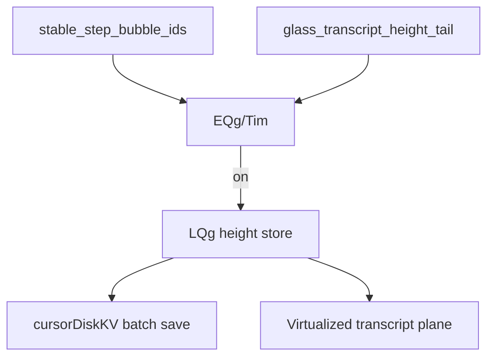

# Detective plan: `glass_transcript_height_tail`

## Objective

Document transcript height tail store, gating, and persistence hooks in Glass and desktop composer.

**Theme:** `feature-flag-glass-transcript-height-tail`

**Success criteria:** Registry entry confirmed; bundle consumers cataloged; on/off behavior stated with evidence tags; local override status recorded.

**Assumptions:** Extracted Cursor 3.25.4 bundles match production; `_l` / `yb` / `checkFeatureGate` are client feature-gate reads.

**Unknowns:** Per-user gate overrides without `state.vscdb`.

## Environment

- **OS:** Linux (cloud agent VM)
- **Cursor version:** 3.25.4 (`commit_sha` ad3448499a35d8ad059c4f95e50d40ae862d9d45 per `feature-flags-inventory.json`)
- **locate-cursor.sh:** exit 0; `WORKBENCH_JS` empty (no live install on VM)
- **Workbench bundles used (extract):**
  - Desktop: `/workspace/workspace/runs/20261015T110519Z/extract/new/usr/share/cursor/resources/app/out/vs/workbench/workbench.desktop.main.js`
  - Glass: `/workspace/workspace/runs/20261015T110519Z/extract/new/usr/share/cursor/resources/app/out/vs/workbench/workbench.glass.main.js`
- **Registry symbols:** desktop `zLe`; glass `kAe` (client flag maps include each flag with `client:!0,default:!1`)

## Feature flag summary

| Field | Value |
|-------|-------|
| Flag | `glass_transcript_height_tail` |
| Registry | **Confirmed** — client true, default false (`zLe` desktop / `kAe` glass) |
| Local override (`state.vscdb`) | **None probed** — DB missing on VM |
| `registry_only` | **false** |
| Confidence | **Confirmed** |

## Scan checklist

| Script | Exit | Result |
|--------|------|--------|
| `locate-cursor.sh` | 0 | No local Cursor install; empty `WORKBENCH_JS` |
| `scan-paths.sh` | 0 | `global_state_vscdb_exists=false`; `projects_root_exists=true` |
| `grep-workbench.sh` (per flag) | 0 | Registry + consumer hits in glass (and desktop where noted) |
| `inspect-state-vscdb.sh` | 1 | `state.vscdb not found` at `~/.config/Cursor/User/globalStorage/state.vscdb` |

## Findings

### Registry (**Confirmed**)

- `client: true`, `default: false` in inventory + both bundles.

### Gating (**Confirmed**)

- Glass: `EQg(experimentService,{logExposure})` requires **both** `stable_step_bubble_ids` (exposure log disabled) and `glass_transcript_height_tail`.
- Desktop: identical pattern via `Tim()` and `$tS = "glass_transcript_height_tail"`.

### Store (**Confirmed** — `composerTranscriptHeightTail.js`)

- `LQg` class with limits `Pjl`: `{chatsInMemory:32, heightsPerChat:1000, foldsPerChat:200, chatsPerSave:16, chatsOnDisk:64}`.
- Keys prefixed per surface (`glass` vs `ide`) via `DQg`.
- Methods: `prefetch`, `open`, `record`, `noteWindow`, `setFold`, `save` (batch to `cursorDiskKVSetBatch`), `prune` (LRU by saved timestamp).
- Serialized payload includes layout string, height tuples, fold map, version `YEs`.

### Consumers (**Confirmed**)

- **Glass plane** — `Qpv` transcript source constructed with `heightTail: EQg(...) ? { store: VEs(env), storage, conversationId, surface } : undefined`.
- **Desktop plane** — `UkS` with `heightTail: Tim(...) ? { store: cwr(...), ... } : undefined`.
- **Composer data service** — `_isTranscriptHeightTailEnabled()`, `prefetchTranscriptHeightTail`, save on shutdown, prune on init when enabled.

**Default off:** Virtualized transcript runs without persisted height tail (no disk KV height cache).

## Internal code map

| Layer | Role |
|-------|------|
| `EQg` / `Tim` | Combined feature gate |
| `LQg` / `VEs` | In-memory + disk height/fold cache |
| Plane host (`Qpv`/`UkS`) | Supplies tail store to row layout |
| Composer service | Prefetch/save/prune lifecycle |

### Implementation snippet (**Confirmed**)

`AQg="glass_transcript_height_tail"`, `LQg` store with `cursorDiskKVGet/SetBatch`, and `heightTail:EQg(...)?{store:VEs(...)}:void 0` in `workbench.glass.main.js`.

## Diagram

## Gaps & follow-ups

- No running Glass app UX validation on this VM.
- Per-user Statsig/gate overrides not readable without `state.vscdb`.

## Workspace relevance

Forensics against pinned extract under `workspace/runs/20261015T110519Z/`; no writes to `~/.cursor` or install trees.

